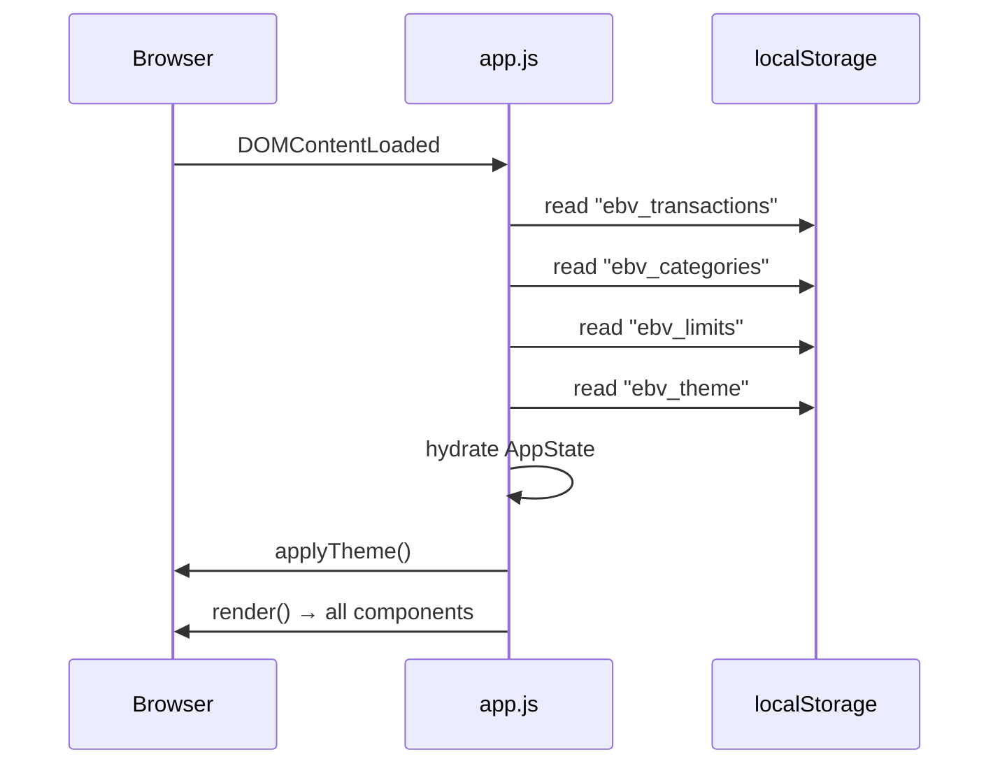

# Design Document: Expense & Budget Visualizer

## Overview

The Expense & Budget Visualizer is a fully client-side, single-page web application (SPA) built with plain HTML, CSS, and Vanilla JavaScript. All data lives in the browser's `localStorage`. There is no server, no build pipeline, and no external dependencies beyond Chart.js loaded via CDN.

The application lets users record expense transactions, review them in a sortable/filterable list, see a live pie chart of spending by category, define custom categories, set per-category spending limits, filter by calendar month, and switch between dark and light themes. All five optional challenge features are included.

### Key Design Principles

1. **Zero-dependency core** — all business logic is plain ES6+ JavaScript; Chart.js is the only external library and is optional (the chart section degrades gracefully if the CDN fails).
2. **Single source of truth** — the in-memory `AppState` object is authoritative; every render function reads from it and every persistence call writes it to `localStorage`.
3. **Event-driven UI updates** — user actions mutate `AppState` and then call a central `render()` dispatcher, keeping data flow predictable.
4. **Progressive enhancement** — the page is functional with CSS disabled and screen-reader accessible with ARIA labels.

---

## Architecture

The application follows a simple **Model → State → View** pattern without a virtual DOM:

```
User Action (DOM event)
        │
        ▼
  Action Handler          ← validates input, mutates AppState
        │
        ▼
  Persistence Layer       ← serializes AppState to localStorage
        │
        ▼
  Render Dispatcher       ← calls granular render functions
        │
   ┌────┴─────────────────────────────────┐
   ▼        ▼          ▼         ▼        ▼
renderList  renderBalance  renderChart  renderAlerts  renderUI
```

Because everything runs in a single browser process with no async server calls, the state mutation → persist → render cycle completes synchronously and well within the 100 ms responsiveness requirement (NFR-2).

### File Structure

```
index.html          ← markup, CDN <script> for Chart.js, entry point
css/
  style.css         ← all styling, CSS custom properties for theming
js/
  app.js            ← all JavaScript: state, logic, persistence, rendering
```

This satisfies TC-4 exactly.

### Execution Flow on Page Load



---

## Components and Interfaces

All components are rendered into static placeholder `<div>` elements defined in `index.html`. JavaScript targets them by `id`.

### DOM Structure (index.html skeleton)

```
<body data-theme="light|dark">
  <header>
    #balance-display        ← Balance_Display
    #theme-toggle           ← Dark/Light Mode Toggle (Req 11)
  </header>

  <main>
    <section id="input-section">
      #transaction-form     ← Input_Form (Req 1)
      #custom-category-form ← Custom Category input (Req 7)
    </section>

    <section id="controls-section">
      #month-selector       ← Monthly Summary selector (Req 8)
      #sort-controls        ← Sort controls (Req 9)
      #limit-section        ← Spending Limit inputs (Req 10)
    </section>

    <section id="chart-section">
      #chart-canvas         ← Chart.js pie chart (Req 5)
    </section>

    <section id="list-section">
      #transaction-list     ← Transaction_List (Req 2, 3)
    </section>
  </main>

  <div id="notification-area">  ← Error notifications (Req 3.5, 6.4, 6.5)
```

### JavaScript Module Layout (inside app.js)

```
app.js
├── Constants
│   ├── STORAGE_KEYS
│   ├── DEFAULT_CATEGORIES
│   └── VALIDATION constants
│
├── AppState (single mutable object)
│
├── Persistence Layer
│   ├── loadFromStorage()
│   ├── saveTransactions()
│   ├── saveCategories()
│   ├── saveLimits()
│   └── saveTheme()
│
├── Business Logic
│   ├── addTransaction(data)
│   ├── deleteTransaction(id)
│   ├── addCustomCategory(name)
│   ├── setSpendingLimit(category, amount)
│   ├── getFilteredTransactions()   ← applies month filter + sort
│   ├── getCategoryTotals(txList)
│   └── isOverLimit(category)
│
├── Validation
│   ├── validateTransactionInput(data)
│   └── validateCategoryName(name)
│
├── Render Functions
│   ├── render()                    ← dispatcher
│   ├── renderBalance(txList)
│   ├── renderTransactionList(txList)
│   ├── renderChart(txList)
│   ├── renderLimitIndicators()
│   └── renderCategorySelects()
│
├── Theme
│   ├── applyTheme(theme)
│   └── detectSystemTheme()
│
├── Notifications
│   └── showNotification(message, type)
│
└── Event Listeners (init)
```

### Public Interface Contracts

| Function | Input | Output / Side Effect |
|---|---|---|
| `addTransaction(data)` | `{name, amount, category}` | Mutates `AppState.transactions`, saves, renders |
| `deleteTransaction(id)` | `string` UUID | Mutates `AppState.transactions`, saves, renders |
| `addCustomCategory(name)` | `string` | Mutates `AppState.customCategories`, saves, renders selects |
| `setSpendingLimit(cat, amt)` | `string, number` | Mutates `AppState.limits[cat]`, saves, renders indicators |
| `getFilteredTransactions()` | — | Returns `Transaction[]` filtered by `AppState.activeMonth` and sorted by `AppState.sortOption` |
| `getCategoryTotals(list)` | `Transaction[]` | Returns `Record<string, number>` |

---

## Data Models

### Transaction

```js
{
  id:        string,   // crypto.randomUUID() or Date.now().toString() fallback
  name:      string,   // 1–100 characters
  amount:    number,   // parsed float, 0.01–999999999.99, max 2 decimal places
  category:  string,   // must exist in allCategories()
  timestamp: number    // Date.now() at time of creation (milliseconds)
}
```

### AppState

```js
const AppState = {
  transactions:     Transaction[],     // all stored transactions
  customCategories: string[],          // user-defined category names (max 20)
  limits:           Record<string, number>, // { "Food": 500.00, ... }
  theme:            "light" | "dark",
  activeMonth:      string | null,     // "YYYY-MM" format, null = all months
  sortOption:       SortOption         // see below
}
```

### SortOption (enum-like constants)

```js
const SORT = {
  CHRONOLOGICAL_DESC: "chronological_desc",  // default
  AMOUNT_ASC:         "amount_asc",
  AMOUNT_DESC:        "amount_desc",
  CATEGORY_AZ:        "category_az"
}
```

### localStorage Schema

| Key | Value Type | Content |
|---|---|---|
| `ebv_transactions` | JSON string | `Transaction[]` |
| `ebv_categories` | JSON string | `string[]` (custom categories only) |
| `ebv_limits` | JSON string | `Record<string, number>` |
| `ebv_theme` | JSON string | `"light"` or `"dark"` |

All reads are wrapped in `try/catch`; failures trigger the error notification (Req 6.4).

### Derived Data (computed on demand, never stored)

- **allCategories()** — `[...DEFAULT_CATEGORIES, ...AppState.customCategories]`
- **getCategoryTotals(txList)** — iterates the given transaction list and sums by category
- **isOverLimit(category)** — compares `getCategoryTotals(AppState.transactions)[category]` against `AppState.limits[category]`

### Validation Rules

| Field | Rule |
|---|---|
| Transaction name | non-empty string, ≤ 100 chars |
| Transaction amount | parseable float, 0.01 ≤ x ≤ 999,999,999.99, ≤ 2 decimal places |
| Transaction category | must be present in `allCategories()` |
| Custom category name | 1–50 chars, case-insensitive unique across `allCategories()` |
| Spending limit | parseable float, 0.01 ≤ x ≤ 999,999,999.99 |

### Chart.js Integration

The pie chart is a `Chart` instance stored in `AppState._chartInstance`. On each render cycle `renderChart()` calls `chart.data.datasets[0].data = [...]` and `chart.update()` rather than destroying and recreating, which keeps animation smooth and avoids canvas memory leaks.

Colors are assigned deterministically from a fixed palette array; the index is derived from `allCategories().indexOf(category)` so colors remain stable across sessions.

---

## Correctness Properties

*A property is a characteristic or behavior that should hold true across all valid executions of a system — essentially, a formal statement about what the system should do. Properties serve as the bridge between human-readable specifications and machine-verifiable correctness guarantees.*

---

### Property 1: Valid transaction addition grows the list

*For any* transaction list and any valid transaction data (non-empty name ≤ 100 chars, amount in range with ≤ 2 decimal places, existing category), calling `addTransaction` must result in the transaction list being exactly one element longer and the new transaction being present in the list.

**Validates: Requirements 1.2**

---

### Property 2: Invalid transaction input is rejected

*For any* transaction input where at least one field is empty, or the amount is outside the valid range (< 0.01, > 999,999,999.99, or has more than 2 decimal places), `validateTransactionInput` must return an error and the transaction list must remain unchanged.

**Validates: Requirements 1.3, 1.4**

---

### Property 3: Default sort is reverse chronological

*For any* non-empty list of transactions with distinct timestamps, `getFilteredTransactions()` with no sort option active must return a list where every element's `timestamp` is greater than or equal to the next element's `timestamp` (descending order).

**Validates: Requirements 2.1, 9.5**

---

### Property 4: Amount formatting is always two decimal places

*For any* transaction with a valid amount, the string produced by the render function for that transaction's amount must match the regex `/^\d+\.\d{2}$/` — exactly two decimal places, no more.

**Validates: Requirements 2.2, 4.1**

---

### Property 5: Transaction persistence round-trip

*For any* non-empty set of transactions, serializing via `saveTransactions()` and then deserializing via `loadFromStorage()` must produce a transaction array that is structurally identical to the original (same ids, names, amounts, categories, and timestamps).

**Validates: Requirements 2.4, 6.1, 6.2, 6.3**

---

### Property 6: Deletion removes exactly the target transaction

*For any* transaction list with at least one element, calling `deleteTransaction(id)` for a valid id must result in a list that (a) no longer contains that id, (b) contains all other transactions unchanged, and (c) reflects the deletion in `localStorage`.

**Validates: Requirements 3.2**

---

### Property 7: Balance equals sum of displayed transactions

*For any* list of displayed transactions (after any active month filter), `renderBalance` must display a value equal to `transactions.reduce((s, t) => s + t.amount, 0)` rounded to exactly 2 decimal places. This holds for empty lists (displays `0.00`) and after any add or delete operation.

**Validates: Requirements 3.3, 4.1, 4.4**

---

### Property 8: Chart data matches category totals

*For any* non-empty list of displayed transactions, the `data` array in the Chart.js dataset must equal the values of `getCategoryTotals(displayedTransactions)`, with each entry corresponding to its category in the same positional order. Over-limit categories must use the alert color; compliant categories must not.

**Validates: Requirements 3.4, 5.1, 10.4**

---

### Property 9: Chart legend colors are unique

*For any* set of two or more categories that each have at least one transaction, no two categories in the chart legend shall share the same color value.

**Validates: Requirements 5.5**

---

### Property 10: Custom category addition makes it available

*For any* valid category name (1–50 chars, not already present case-insensitively in `allCategories()`), calling `addCustomCategory(name)` must result in that name appearing in `allCategories()` and being available as an option in the category selector.

**Validates: Requirements 7.2**

---

### Property 11: Custom category persistence round-trip

*For any* set of custom categories, serializing via `saveCategories()` and then deserializing via `loadFromStorage()` must produce a category array identical to the original (case-preserved, order-preserved).

**Validates: Requirements 7.3, 7.4**

---

### Property 12: Invalid category names are rejected

*For any* category name that is empty, exceeds 50 characters, or is a case-insensitive duplicate of any existing category (default or custom), `validateCategoryName` must return an error and `customCategories` must remain unchanged.

**Validates: Requirements 7.5**

---

### Property 13: Month filter returns only in-month transactions

*For any* non-empty list of transactions with varied timestamps and any selected `YYYY-MM` month string, `getFilteredTransactions()` must return only transactions whose timestamp falls within that calendar month, and must return zero transactions for any month where none were recorded.

**Validates: Requirements 8.2, 8.6**

---

### Property 14: Clearing month filter restores full list

*For any* active month filter and any transaction list, setting `activeMonth` to `null` and calling `getFilteredTransactions()` must return the complete unfiltered transaction list.

**Validates: Requirements 8.5**

---

### Property 15: Sort ordering is correct for each option

*For any* non-empty list of transactions and any active `SortOption`, `getFilteredTransactions()` must return a list that is fully ordered according to that sort criterion — amounts ascending, amounts descending, or categories alphabetically A–Z — with ties broken by timestamp descending.

**Validates: Requirements 9.2, 9.3**

---

### Property 16: Over-limit indicator tracks the threshold

*For any* category and any set of transactions, `isOverLimit(category)` must return `true` if and only if `getCategoryTotals(transactions)[category] > AppState.limits[category]`. When `isOverLimit` is `true`, every transaction row in that category must have the over-limit CSS class applied; when `false` (including when no limit is defined), no transaction row in that category may carry the over-limit class.

**Validates: Requirements 10.3, 10.5, 10.6**

---

### Property 17: Spending limit persistence round-trip

*For any* map of category → limit values, serializing via `saveLimits()` and then deserializing via `loadFromStorage()` must produce an identical limits map (same keys, same numeric values).

**Validates: Requirements 10.7**

---

### Property 18: Theme application is exhaustive and stable

*For any* call to `applyTheme(t)` where `t` is `"light"` or `"dark"`, `document.body.dataset.theme` must equal `t` after the call, and `localStorage.getItem("ebv_theme")` must also equal `t` (when localStorage is available). Calling `applyTheme` with the same value twice must produce the same result as calling it once (idempotence).

**Validates: Requirements 11.2, 11.3, 11.4**

---

## Error Handling

All error paths follow a single pattern: **fail-safe with user notification and state rollback**.

### localStorage Failures

All localStorage reads and writes are wrapped in `try/catch`:

```js
function saveTransactions() {
  try {
    localStorage.setItem(STORAGE_KEYS.TRANSACTIONS, JSON.stringify(AppState.transactions));
  } catch (e) {
    showNotification("Could not save changes. Your browser storage may be full or unavailable.", "error");
  }
}
```

On **read failure** (load time):
- Show persistent error notification (dismissible, per Req 6.4).
- Initialize `AppState` with empty defaults so the app remains usable.

On **write failure** (add/delete/save):
- Show persistent error notification (per Req 6.5, 3.5, 7.7).
- For deletion: rollback `AppState.transactions` to pre-deletion snapshot before the save was attempted.

### Input Validation Errors

Validation runs before any state mutation. Each validation function returns a result object:

```js
// Returns { valid: true } or { valid: false, errors: { field: message } }
function validateTransactionInput({ name, amount, category }) { ... }
```

Error messages are injected adjacent to the failing field using `insertAdjacentHTML`. They are cleared before each re-validation attempt.

### Chart.js Unavailable

If `Chart` is not defined (CDN failure), `renderChart` logs a warning and shows a fallback text summary of category totals inside `#chart-canvas`'s parent. All other functionality is unaffected.

### Edge Cases

| Scenario | Handling |
|---|---|
| `crypto.randomUUID()` unavailable | Fall back to `Date.now() + Math.random()` string ID |
| `matchMedia` unavailable (Req 11.6) | Default to `"light"` theme |
| localStorage quota exceeded | Caught by `try/catch`; notification shown |
| Amount precision drift (floating-point) | All amounts rounded with `Math.round(x * 100) / 100` before storage |
| Category deleted while transactions reference it | Categories are immutable once assigned; orphaned categories are preserved in their transactions' `category` field and re-added to `allCategories()` at load time if found in transactions |

---

## Testing Strategy

This is a pure client-side Vanilla JS application with no build tool or test runner configured (TC-1, TC-4). Testing is therefore split into two tiers.

### Tier 1 — Property-Based Tests (automated, in-browser)

**Library**: [fast-check](https://fast-check.io/) loaded via CDN in a separate `tests/index.html` test harness that imports `app.js` with `type="module"`.

Each correctness property maps to one property-based test configured to run **minimum 100 iterations**.

Tag format per test:
```js
// Feature: expense-budget-visualizer, Property N: <property_text>
```

| Property | Test File | fast-check Arbitraries |
|---|---|---|
| P1 — Valid add grows list | `tests/transactions.test.js` | `fc.record({ name: fc.string(1,100), amount: fc.float(...), category: fc.constantFrom(...) })` |
| P2 — Invalid input rejected | `tests/validation.test.js` | `fc.oneof(fc.constant({name:""}), fc.float({max:0}), fc.float({min:1e9}))` |
| P3 — Default sort chronological | `tests/sort.test.js` | `fc.array(transactionArb, {minLength:2})` |
| P4 — Amount formatting 2dp | `tests/render.test.js` | `fc.float({min:0.01, max:999999999.99})` |
| P5 — Persistence round-trip (transactions) | `tests/persistence.test.js` | `fc.array(transactionArb)` |
| P6 — Delete removes target | `tests/transactions.test.js` | `fc.array(transactionArb, {minLength:1})` |
| P7 — Balance = sum of displayed | `tests/balance.test.js` | `fc.array(transactionArb)` |
| P8 — Chart data = category totals | `tests/chart.test.js` | `fc.array(transactionArb, {minLength:1})` |
| P9 — Chart legend colors unique | `tests/chart.test.js` | `fc.array(fc.string(1,50), {minLength:2})` |
| P10 — Category add makes available | `tests/categories.test.js` | `fc.string(1,50)` |
| P11 — Category persistence round-trip | `tests/persistence.test.js` | `fc.array(fc.string(1,50), {maxLength:20})` |
| P12 — Invalid category rejected | `tests/validation.test.js` | `fc.oneof(fc.constant(""), fc.string(51,100), duplicateGen)` |
| P13 — Month filter correctness | `tests/filter.test.js` | `fc.array(transactionArb)` + `fc.string({minLength:7,maxLength:7})` |
| P14 — Clear filter restores full list | `tests/filter.test.js` | `fc.array(transactionArb, {minLength:1})` |
| P15 — Sort ordering correct | `tests/sort.test.js` | `fc.array(transactionArb, {minLength:2})` + `fc.constantFrom(...SORT)` |
| P16 — Over-limit indicator tracks threshold | `tests/limits.test.js` | `fc.array(transactionArb, {minLength:1})` + `fc.float({min:0.01})` |
| P17 — Limit persistence round-trip | `tests/persistence.test.js` | `fc.dictionary(fc.string(), fc.float({min:0.01}))` |
| P18 — Theme application idempotent | `tests/theme.test.js` | `fc.constantFrom("light","dark")` |

### Tier 2 — Example-Based Tests (manual / browser DevTools)

For structural, visual, and edge-case acceptance criteria not covered by properties:

| Scenario | Method |
|---|---|
| Form fields present in DOM (Req 1.1) | Browser DevTools: `document.querySelector("#transaction-form")` |
| Scrollable list layout (Req 2.3) | Visual check with 50+ transactions |
| Empty state messages (Req 2.5, 5.4, 8.6) | Delete all transactions; verify empty-state copy shown |
| localStorage failure notification (Req 6.4) | DevTools: Override `localStorage.getItem` to throw; reload page |
| localStorage write failure (Req 3.5, 6.5) | DevTools: Override `localStorage.setItem` to throw; add/delete |
| Max 20 custom categories limit (Req 7.6) | Add 20 categories; verify input disabled |
| Sort on empty list (Req 9.6) | Select sort with no transactions; add one; verify sorted |
| No limit → no indicator (Req 10.6) | Ensure no spending limit set; add transactions; verify no highlight |
| OS color scheme fallback (Req 11.5, 11.6) | Clear localStorage; set/remove `prefers-color-scheme` media query |
| localStorage unavailable for theme (Req 11.7) | Disable Storage in DevTools Application tab |

### Unit Testing Balance

- Property tests handle universal invariants and cover the vast majority of input space.
- Example tests focus on structural DOM verification and environment-dependent edge cases.
- Avoid redundant unit tests for behaviors already covered by property tests.
- Each property test must reference its design property via the tag comment.
